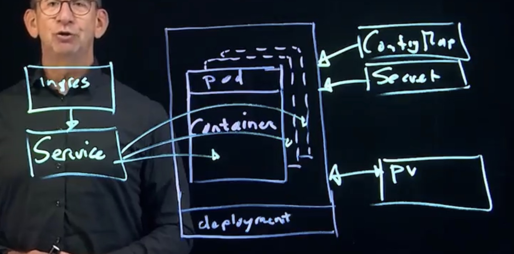

# 02 · Kubernetes 是怎么工作的：架构与资源模型

> 系列：[Kubernetes 实战](../articles/README.md)（英文索引）· 英文原文：[How Kubernetes Works](../articles/02-kubernetes-architecture.md) · 上一篇：[01 · 容器与镜像](01-containers-and-images.md) · 下一篇：[03 · Lab Setup and kubectl（英文）](../articles/03-lab-setup-and-kubectl.md)

## 缩写对照表

| 缩写 | 英文全称 | 中文 |
|---|---|---|
| CNCF | Cloud Native Computing Foundation | 云原生计算基金会 |
| API | Application Programming Interface | 应用程序编程接口 |
| REST | Representational State Transfer | 表述性状态转移 |
| IP | Internet Protocol | 网际协议（此处指 IP 地址） |
| DNS | Domain Name System | 域名系统 |
| HTTP(S) | Hypertext Transfer Protocol (Secure) | （安全）超文本传输协议 |
| CRI-O | Container Runtime Interface – Open Container Initiative | 基于 CRI 与 OCI 规范的容器运行时 |
| EKS / AKS / GKE | Amazon Elastic Kubernetes Service / Azure Kubernetes Service / Google Kubernetes Engine | 三大公有云的托管 Kubernetes 服务 |

## Kubernetes 为什么存在：云原生

一个面向互联网的应用，不应该绑死在某一台服务器上：那台服务器宕机了，应用应该能在别处继续跑。可一旦应用不再属于某台服务器，有几个问题就需要重新回答：

- **配置**：如果不是从「自己那台」服务器上的文件读，应用的配置从哪里来？
- **存储**：容器可能被挪到任意节点，数据存在哪里？
- **访问**：应用的 IP（Internet Protocol，网际协议）地址一直在变，用户怎么找到它？

**云原生（cloud native）计算**用平台能力来回答这些问题，而 Kubernetes 就是为容器做这件事的开源平台。它：

- **编排（orchestrate）**容器，确保它们运行在该运行的地方；
- **扩缩（scale）**容器，确保有足够的副本承接负载；
- 提供 **API（Application Programming Interface，应用程序编程接口）资源**（Pod、Deployment、ConfigMap、Service、PersistentVolume……），把配置、数据和访问规则存在集群里，而不是某台服务器上。

Kubernetes 源自 Google 内部的 **Borg** 系统，2014 年 6 月发布，2015 年捐赠给**云原生计算基金会（CNCF，Cloud Native Computing Foundation）**。

## 生态与发行版

「原版」（vanilla）Kubernetes 是刻意做得不完整的：没有内置的 Ingress 控制器，没有网络插件，也没有存储后端。CNCF 托管了大量项目来填补这些空缺，同一件事往往有好几个相互竞争的项目。

你可以自己挑项目、自己集成，也可以直接用一个已经集成好的**发行版（distribution）**：

| 类型 | 例子 |
|------|------|
| 云托管 | Amazon EKS、Azure AKS、Google GKE |
| 本地机房 / 私有云 | Red Hat OpenShift、Rancher、Google Anthos、Canonical Kubernetes |
| 本地学习 | Minikube、kind、k3d |

有些发行版是「有主见的」（opinionated），每类问题只给你一种选择；有些则让你自己选。商业发行版还会卖技术支持。

## 架构：控制平面与工作节点



### 控制平面：大脑

| 组件 | 作用 |
|------|------|
| **kube-apiserver** | 正门。所有命令、控制器和节点，都通过这个 REST（Representational State Transfer，表述性状态转移）API 和集群打交道。 |
| **etcd** | 键值数据库，保存整个集群的状态。 |
| **kube-scheduler** | 根据资源、规则和约束，决定新 Pod 该跑在**哪个节点**上。 |
| **kube-controller-manager** | 运行各种控制循环，让实际情况始终等于你要求的样子（ReplicaSet、Endpoints、Node 等）。 |

### 工作节点：肌肉

| 组件 | 作用 |
|------|------|
| **kubelet** | 节点代理。它通过 API 盯着分配到本节点的 Pod，让运行时把其中的容器启动起来；同时执行探针并上报状态。 |
| **容器运行时** | containerd 或 CRI-O，负责拉镜像、跑容器。 |
| **kube-proxy** | 在节点上设置网络规则，让 Service 的 IP 能用（见[第 7 篇，英文](../articles/07-services-and-networking.md)）。 |

### 期望状态：最重要的一个概念

你从来不会对 Kubernetes 说「在节点 Y 上启动容器 X」。你做的是**声明期望状态（desired state）**，比如「我要 3 个 nginx:1.27 的副本」，通过 API server 存进 etcd。然后**控制器**不停地比较*期望*状态和*实际*状态，动手调整，直到两者一致。

这就是**调谐循环（reconciliation loop）**。Kubernetes 的很多行为都可以用它来解释：

- 删掉一个属于 Deployment 的 Pod，马上又会冒出一个新的：ReplicaSet 控制器看到 3 个只剩 2 个，就补上了。
- 改了 Deployment 里的镜像，滚动更新就开始了：Deployment 控制器看到了新的模板。
- 给 Pod 加一个标签，它就进入了某个 Service：endpoints 控制器看到了选择器匹配。

## 资源模型

Kubernetes 里的一切都是 **API 资源**，而且结构相同：

```yaml
apiVersion: apps/v1        # API group + version
kind: Deployment           # resource type
metadata:                  # name, namespace, labels, annotations
  name: web
  labels:
    app: web
spec:                      # desired state (you write this)
  replicas: 3
  ...
status:                    # actual state (Kubernetes writes this)
  ...
```

天天都会用到的核心资源：

| 资源 | 用途 |
|------|------|
| **Pod** | Kubernetes 管理的最小单位。一个或多个共享网络和存储的容器。 |
| **Deployment** | 为 Pod 提供副本、自愈和零停机更新。 |
| **ConfigMap / Secret** | 配置和敏感值，不打进镜像里。 |
| **Service** | 一个稳定的 IP 和 DNS（Domain Name System，域名系统）名称，把流量负载均衡到一组 Pod。 |
| **Ingress / Gateway API** | 从集群外到 Service 的 HTTP(S)（超文本传输协议）路由。 |
| **PersistentVolume(Claim)** | 寿命比任何一个 Pod 都长的存储。 |
| **Namespace** | 资源的「文件夹」，限定名称、配额和权限的作用范围。 |

### 在命令行里探索资源

```bash
kubectl api-resources | less         # every resource type, short name, API group
kubectl api-resources --namespaced=false   # cluster-wide types (nodes, pv, sc, ...)
kubectl api-versions                 # every group/version the server supports
kubectl explain pod                  # built-in documentation
kubectl explain pod.spec.containers.livenessProbe
kubectl explain deploy --recursive | less  # the full field tree
```

`kubectl explain` 是你的离线参考手册：它永远和集群版本同步，考试里也能用。`api-resources` 列出的短名能省很多键盘：`po`、`deploy`、`svc`、`cm`、`ns`、`pv`、`pvc`、`sc`、`netpol`、`ing`、`sa`。

## 要点回顾

- 控制平面（API server、etcd、scheduler、controller-manager）负责存储和调谐状态；节点（kubelet、运行时、kube-proxy）负责运行工作负载。
- 你声明期望状态，控制器把它变成现实。看到什么东西「自己修好了」，那是某个控制器干的。
- 每个对象都有 `apiVersion`、`kind`、`metadata`、`spec` 和 `status`。
- 「那个字段叫什么来着？」这类问题，`kubectl api-resources` 和 `kubectl explain` 基本都能回答。

下一篇：[搭一个实验集群，熟悉 kubectl 的工作方式（英文）](../articles/03-lab-setup-and-kubectl.md)。
