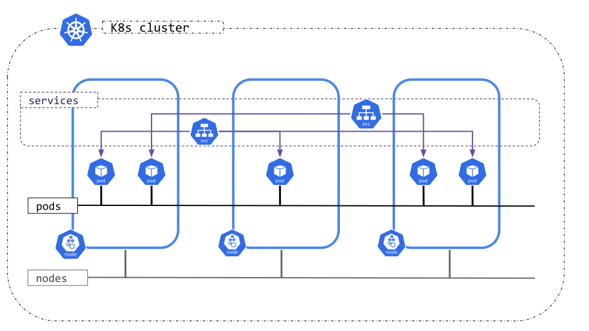

# 07 · 网络：Service、DNS 与 NetworkPolicy

> 系列：[Kubernetes 实战](../articles/README.md)（英文索引）· 英文原文：[Networking](../articles/07-services-and-networking.md) · 上一篇：[06 · 持久化数据](06-storage.md) · 下一篇：[08 · 把流量引进来](08-ingress-and-gateway-api.md)

> 「Service 不过是一个网络概念。」

## 缩写对照表

| 缩写 | 英文全称 | 中文 |
|---|---|---|
| IP | Internet Protocol | 网际协议（此处指 IP 地址） |
| NAT | Network Address Translation | 网络地址转换 |
| CNI | Container Network Interface | 容器网络接口 |
| DNS | Domain Name System | 域名系统 |
| CNAME | Canonical Name | 规范名称（DNS 别名记录） |
| CIDR | Classless Inter-Domain Routing | 无类别域间路由 |
| mTLS | Mutual Transport Layer Security | 双向传输层安全 |
| TCP / UDP | Transmission Control Protocol / User Datagram Protocol | 传输控制协议 / 用户数据报协议 |
| API | Application Programming Interface | 应用程序编程接口 |

## Kubernetes 的网络模型


Kubernetes 做了三个承诺：

1. 每个 Pod 都有**自己的 IP 地址**。
2. 任何 Pod 都能直接访问其他 Pod，**不管在哪个节点、哪个命名空间**，中间不做 NAT（Network Address Translation，网络地址转换）。
3. 节点上的代理程序（比如 kubelet）能访问本节点上的所有 Pod。

这张网不是 Kubernetes 自己搭的，而是由 **CNI（Container Network Interface，容器网络接口）网络插件**搭的，比如 Calico、Cilium、Flannel。有三段地址范围不能重叠：

| 地址范围 | 由谁分配 |
|-------|-------------|
| Pod IP | 网络插件 |
| Service（ClusterIP）IP | kube-apiserver（`--service-cluster-ip-range`） |
| 节点 IP | kubelet 或 cloud-controller-manager |



Pod 的 IP 是**临时的**：Deployment 每替换一个 Pod，新 Pod 就换一个新 IP。所以客户端需要一个稳定的连接目标，这就是 Service。

## Service

**Service** 给一组 Pod 提供一个稳定的虚拟 IP 和 DNS（Domain Name System，域名系统）名称，并在它们之间对连接做负载均衡。

- 这组 Pod 由**标签选择器**选定。
- 有个控制器持续寻找匹配且处于 **Ready** 状态的 Pod，把它们的 IP 存为 Service 的**端点（endpoints，即 EndpointSlice）**。
- 每个节点上的 kube-proxy（或 CNI）把发往 Service IP 的流量路由到其中一个端点。

Service 和 Deployment 是**解耦**的：Service 不知道 Pod 是哪个 Deployment 建的，删掉 Deployment 也不会删掉 Service。这是有意为之：一个 Service 可以同时覆盖**多个** Deployment 的 Pod，金丝雀发布就是这么做的（[第 10 篇，英文](../articles/10-deployment-strategies.md)）。

> **动手试试：**[交互实验](../articles/interactive/k8s-visual-labs.html#services)里的 *Services & selectors* 标签页，可以修改选择器、标签、就绪状态和 `targetPort`，看哪些 Pod 会成为端点。

### Service 的类型

| 类型 | 从哪里能访问 | 实现方式 |
|------|----------------|-----|
| `ClusterIP`（默认） | 只能在集群内 | 从 Service 地址段分配的虚拟 IP |
| `NodePort` | 集群外，通过 `<任一节点 IP>:<30000-32767>` | ClusterIP + 在每个节点上开一个端口 |
| `LoadBalancer` | 集群外，通过云负载均衡器 | NodePort + 云厂商提供的负载均衡器 |
| `ExternalName` | 集群内 | 指向外部名称的 DNS CNAME（Canonical Name，别名记录），不做代理，迁移时很有用 |
| Headless（`clusterIP: None`） | 集群内 | 没有虚拟 IP，DNS 直接返回 Pod IP，StatefulSet 会用到 |

### 三个端口

```yaml
ports:
- port: 80          # the Service's own port (clients connect to svc-ip:80)
  targetPort: 8080  # the container port that traffic is sent to
  nodePort: 32000   # NodePort only: the port opened on every node
```

不写 `targetPort` 时，它和 `port` 相同。

### 创建 Service

```bash
kubectl create deploy nginxsvc --image=nginx --replicas=3
kubectl expose deploy nginxsvc --port=80                       # ClusterIP
kubectl describe svc nginxsvc                                  # look at Endpoints
kubectl get endpointslices -l kubernetes.io/service-name=nginxsvc
minikube ssh -- curl -s <cluster-ip>                           # works from the node

kubectl expose deploy nginxsvc --port=80 --type=NodePort --name=nginxsvc-np
kubectl get svc nginxsvc-np                                    # 80:3xxxx/TCP
curl $(minikube ip):3xxxx
```

`kubectl expose` 会从 Deployment（或 Pod）上复制选择器。要固定 NodePort，可以 `kubectl edit svc` 设置 `nodePort: 32000`，或者用 `--dry-run=client -o yaml` 生成 YAML 后加上。还有一种办法是 `kubectl create service nodeport web --tcp=80:80 --node-port=32000`，它的选择器是 `app=web`，记得确认和你的 Pod 匹配。

### 微服务的常见布局

- **后端**（数据库、内部 API）用 `ClusterIP`，不应该能从外部访问。
- **前端**用 `NodePort`/`LoadBalancer` 暴露，更好的做法是放在 **Ingress/Gateway** 后面（[第 8 篇](08-ingress-and-gateway-api.md)）。
- 服务之间要做 mTLS（Mutual Transport Layer Security，双向传输层安全）、重试和流量整形，就加一个 Istio 这样的**服务网格（service mesh）**。它是可选的，不属于 Kubernetes 核心。

## Service 与 DNS

CoreDNS（`kube-system` 里名为 `kube-dns` 的 Service）会自动注册每一个 Service：

```text
<service>.<namespace>.svc.cluster.local
```

- 在**同一个**命名空间里，短名就够了：`curl nginxsvc`。
- 从**另一个**命名空间访问，至少要写 `<service>.<namespace>`，或者写全名。

```bash
kubectl create ns elsewhere
kubectl run nginxpod --image=nginx -n elsewhere
kubectl expose pod nginxpod --port=80 -n elsewhere
kubectl run testpod --image=busybox -- sleep infinity
kubectl exec testpod -- cat /etc/resolv.conf       # search default.svc.cluster.local svc.cluster.local ...
kubectl exec testpod -- wget --spider --timeout=1 nginxpod                                # fails
kubectl exec testpod -- wget --spider --timeout=1 nginxpod.elsewhere.svc.cluster.local    # works
```

短名只在自己的命名空间里有效，原因就在 `/etc/resolv.conf` 的 `search` 那一行。

## 排查 Service 故障（killer.sh 第 18 题）

*「命名空间 `mars` 里的 ClusterIP Service `manager-api-svc` 应该在 4444 端口暴露 Deployment `manager-api-deployment` 的 Pod，现在不通，请修复。」*

按顺序检查：

```bash
kubectl -n mars get svc manager-api-svc -o wide            # selector + ports
kubectl -n mars get pods --show-labels                     # do labels match the selector?
kubectl -n mars get endpoints manager-api-svc              # <none> means selector or readiness problem
kubectl -n mars get deploy manager-api-deployment -o yaml | grep -A3 ports   # real containerPort
kubectl -n mars run tmp --rm -i --restart=Never --image=nginx:alpine -- \
  curl -s -m 2 manager-api-svc.mars:4444
```

Service 不通，几乎都是下面几个原因之一：

1. **选择器和 Pod 标签不匹配**，所以没有端点。
2. **`targetPort` 写错了**：端点是有的，但连接被拒绝。
3. **Pod 没有 Ready**：readinessProbe 失败，Pod 进不了端点列表。
4. 流量被某条 **NetworkPolicy** 挡住了。

用 `kubectl edit svc` 修好后再测一次。

## NetworkPolicy

默认情况下**所有流量都放行**：任何 Pod 都能和任何命名空间里的任何 Pod 通信。**NetworkPolicy** 相当于 Pod 的防火墙。

要记住的规则：

- NetworkPolicy 由**网络插件**执行。Calico、Cilium 支持；有些插件（Flannel，以及某些配置下的 Weave）会悄悄忽略它。在 Minikube 上要用 `--cni=calico`。
- 策略用 `spec.podSelector` *选中* Pod。Pod 一旦在某个方向（`Ingress` 和/或 `Egress`）被选中，**这个方向上凡是没有明确放行的，一律拒绝**。
- 没有被任何策略选中的 Pod 不受影响。
- 策略是**叠加**的，永远不会冲突：放行的流量是选中该 Pod 的所有策略的并集。

### 可以放行谁

| 对端选择器 | 匹配 |
|---------------|---------|
| `podSelector` | **策略所在命名空间内**带这些标签的 Pod |
| `namespaceSelector` | 带这些标签的命名空间里的所有 Pod |
| `namespaceSelector` + `podSelector` **写在同一个列表项里** | **这些命名空间内**带这些标签的 Pod（AND） |
| `ipBlock` | 一段 CIDR（Classless Inter-Domain Routing，无类别域间路由）地址，通常是外部 IP |

> 一个 `-` 差别巨大。两个列表项（`- namespaceSelector…` 和 `- podSelector…`）是**或（OR）**；一个列表项里同时写两个键是**与（AND）**。

### 考试第 8 题：只允许 tester 访问 Web 应用

```bash
kubectl run nevaginx --image=nginx --labels=type=webapp
kubectl expose pod nevaginx --port=80
kubectl run nevatest --image=busybox -- sleep infinity
```

```yaml
apiVersion: networking.k8s.io/v1
kind: NetworkPolicy
metadata:
  name: test-np
spec:
  podSelector:
    matchLabels:
      type: webapp          # protect these Pods
  policyTypes:
  - Ingress
  ingress:
  - from:
    - podSelector:
        matchLabels:
          type: tester      # allow only these
    ports:
    - protocol: TCP
      port: 80
```

```bash
kubectl apply -f task8-np.yaml
kubectl exec nevatest -- wget --spider --timeout=1 nevaginx    # times out
kubectl label pod nevatest type=tester
kubectl exec nevatest -- wget --spider --timeout=1 nevaginx    # remote file exists
kubectl label pod nevatest type-                               # remove the label: blocked again
kubectl describe netpol test-np                                # readable summary
```

> **动手试试：**[交互实验](../articles/interactive/k8s-visual-labs.html#netpol)里的 *NetworkPolicy* 标签页会给出一张放行/拒绝矩阵，并解释每一格的判定理由，可以在那里对比 AND 和 OR 两种写法。

### 常用模式

```yaml
# Default deny all ingress in a namespace
spec:
  podSelector: {}
  policyTypes: [Ingress]
---
# Default deny all egress, but allow DNS
spec:
  podSelector: {}
  policyTypes: [Egress]
  egress:
  - ports:
    - protocol: UDP
      port: 53
    - protocol: TCP
      port: 53
```

收紧出站（egress）时一定要放行 DNS，否则所有域名解析都会失败，看起来就像整个网络坏了。

## 要点回顾

- 每个 Pod 都有 IP，但 Pod IP 会变；Service 提供稳定的 IP、DNS 名称和负载均衡。
- Service 靠标签选择器找 Pod；没有端点，问题就在选择器或就绪状态上。
- DNS 名称是 `svc.namespace.svc.cluster.local`，短名只在同一命名空间内有效。
- NetworkPolicy：被选中的 Pod 在所列方向上默认拒绝，策略之间叠加，而且需要 CNI 支持。

下一篇：[用 Ingress 和 Gateway API 把 HTTP 流量引进集群](08-ingress-and-gateway-api.md)。
