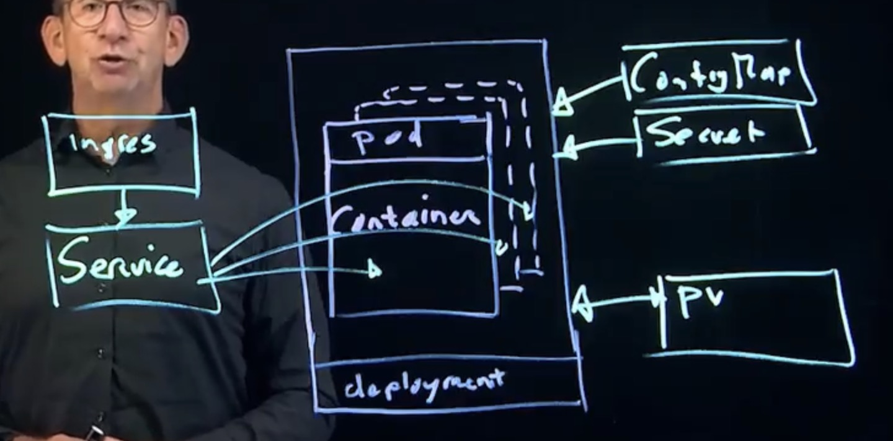

# 2. How Kubernetes Works: Architecture and the Resource Model

> Series: [Working with Kubernetes](README.md) · Previous: [Containers and Images](01-containers-and-images.md) · Next: [Lab Setup and kubectl](03-lab-setup-and-kubectl.md)

## Why Kubernetes exists: cloud native

An app on the internet should not depend on one particular server. If that server dies, the app should keep running somewhere else. But once an app is not tied to a server, some questions need new answers:

- **Configuration**: where does the app read its settings, if not from a file on "its" server?
- **Storage**: where is data kept, if the container can move to any node?
- **Access**: how do users find the app, if its IP address keeps changing?

*Cloud native computing* answers these questions with platform features. Kubernetes is the open-source platform that does this for containers. It:

- **orchestrates** containers, which means it makes sure they run where they should;
- **scales** them, so enough copies run to handle the load;
- provides **API resources** (Pods, Deployments, ConfigMaps, Services, PersistentVolumes …) that store configuration, data and access rules in the cluster instead of on a server.

Kubernetes comes from Google's internal system **Borg**. It was announced in June 2014 and donated to the **Cloud Native Computing Foundation (CNCF)** in 2015.

## The ecosystem and distributions

"Vanilla" Kubernetes is intentionally incomplete. It has no built-in ingress controller, no network plugin and no storage backend. The CNCF hosts many projects that fill these gaps, often several competing ones for the same job.

You can either pick and integrate projects yourself, or use a **distribution** that has already done it:

| Type | Examples |
|------|----------|
| Cloud-managed | Amazon EKS, Azure AKS, Google GKE |
| On-premises / private cloud | Red Hat OpenShift, Rancher, Google Anthos, Canonical Kubernetes |
| Local learning | Minikube, kind, k3d |

Some distributions are *opinionated* and ship exactly one choice per problem. Others let you choose. Commercial distributions also sell support.

## Architecture: control plane and worker nodes



### Control plane: the brain

| Component | Role |
|-----------|------|
| **kube-apiserver** | The front door. Every command, controller and node talks to the cluster through this REST API. |
| **etcd** | The key-value database that stores the entire cluster state. |
| **kube-scheduler** | Decides *which node* a new Pod should run on, based on resources, rules and constraints. |
| **kube-controller-manager** | Runs the control loops that keep reality equal to what you asked for (ReplicaSets, Endpoints, Nodes and more). |

### Worker nodes: the muscle

| Component | Role |
|-----------|------|
| **kubelet** | The node agent. It watches the API for Pods assigned to its node and tells the runtime to start their containers. It also runs probes and reports status. |
| **container runtime** | containerd or CRI-O. It pulls images and runs containers. |
| **kube-proxy** | Programs node networking rules so Service IPs work (see [article 7](07-services-and-networking.md)). |

### Desired state: the most important idea

You never tell Kubernetes "start container X on node Y". You **declare desired state**, for example "I want 3 replicas of nginx:1.27". You store it through the API server in etcd. Then **controllers** keep comparing the *desired* state with the *actual* state and act until they match.

This is the **reconciliation loop**. It explains much of Kubernetes behavior:

- Delete a Pod that belongs to a Deployment, and a new one appears. The ReplicaSet controller saw 2 of 3 and fixed it.
- Change an image in a Deployment, and a rolling update starts. The Deployment controller saw a new template.
- Add a label to a Pod, and it joins a Service. The endpoints controller saw a selector match.

## The resource model

Everything in Kubernetes is an **API resource** with the same basic shape:

```yaml
apiVersion: apps/v1        # API group + version
kind: Deployment           # resource type
metadata:                  # name, namespace, labels, annotations
  name: web
  labels:
    app: web
spec:                      # desired state (you write this)
  replicas: 3
  ...
status:                    # actual state (Kubernetes writes this)
  ...
```

The core resources you will use all the time:

| Resource | Purpose |
|----------|---------|
| **Pod** | The smallest unit Kubernetes manages. One or more containers that share network and storage. |
| **Deployment** | Adds replication, self-healing and zero-downtime updates to Pods. |
| **ConfigMap / Secret** | Configuration and sensitive values, kept out of the image. |
| **Service** | A stable IP and DNS name that load-balances to a set of Pods. |
| **Ingress / Gateway API** | HTTP(S) routing from outside the cluster to Services. |
| **PersistentVolume(Claim)** | Storage that lives longer than any single Pod. |
| **Namespace** | A folder for resources. It scopes names, quotas and permissions. |

### Exploring resources from the command line

```bash
kubectl api-resources | less         # every resource type, short name, API group
kubectl api-resources --namespaced=false   # cluster-wide types (nodes, pv, sc, ...)
kubectl api-versions                 # every group/version the server supports
kubectl explain pod                  # built-in documentation
kubectl explain pod.spec.containers.livenessProbe
kubectl explain deploy --recursive | less  # the full field tree
```

`kubectl explain` is your offline reference. It is always in sync with the cluster's version, and you can use it in the exam. Short names from `api-resources` save typing: `po`, `deploy`, `svc`, `cm`, `ns`, `pv`, `pvc`, `sc`, `netpol`, `ing`, `sa`.

## Key takeaways

- The control plane (API server, etcd, scheduler, controller-manager) stores and reconciles state. Nodes (kubelet, runtime, kube-proxy) run the workloads.
- You declare desired state and controllers make it real. When something "fixes itself", a controller did it.
- Every object has `apiVersion`, `kind`, `metadata`, `spec` and `status`.
- `kubectl api-resources` and `kubectl explain` answer most "what's that field called?" questions.

Next: [build a lab cluster and learn the kubectl workflow](03-lab-setup-and-kubectl.md).
