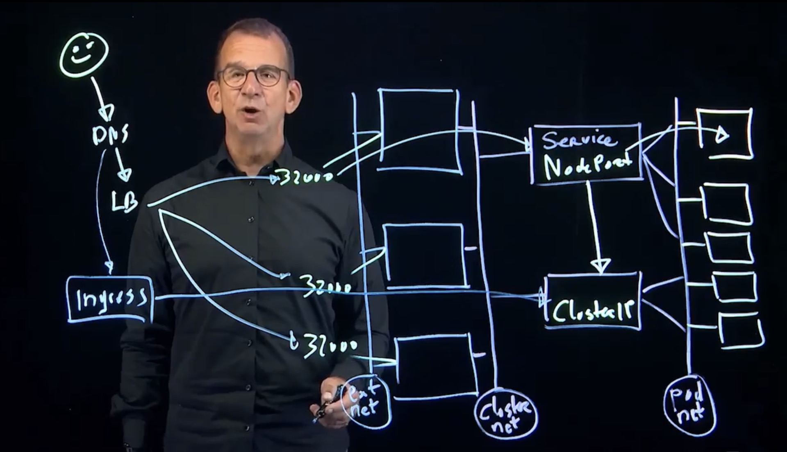
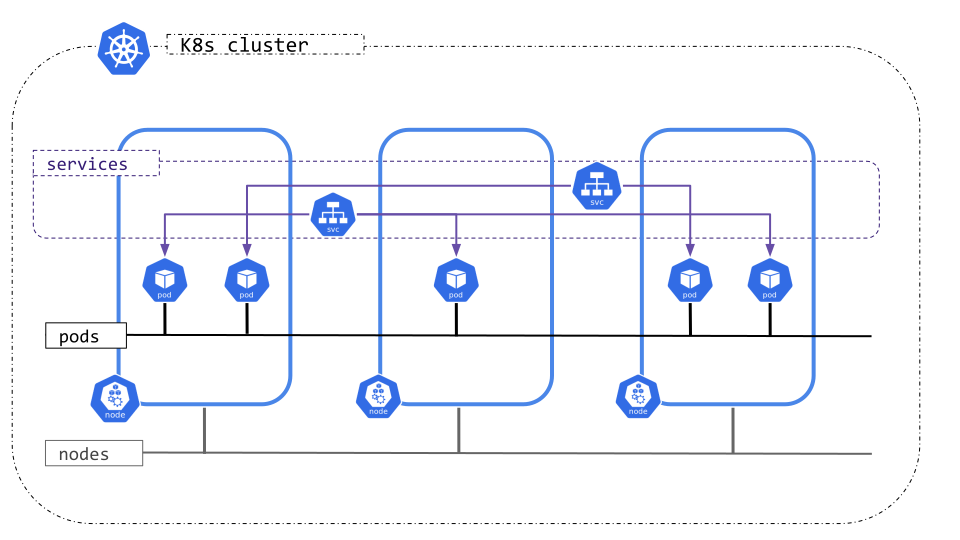

# 7. Networking: Services, DNS and NetworkPolicy

> Series: [Working with Kubernetes](README.md) · Previous: [Storage](06-storage.md) · Next: [Ingress and Gateway API](08-ingress-and-gateway-api.md)

> "A Service is nothing but a networking concept."

## The Kubernetes network model



Kubernetes makes three promises:

1. Every Pod gets its **own IP address**.
2. Every Pod can reach every other Pod directly, **on any node and in any namespace**, without NAT.
3. Agents on a node (such as the kubelet) can reach all Pods on that node.

Kubernetes does not build this network itself. A **CNI network plugin** does, for example Calico, Cilium or Flannel. Three address ranges must not overlap:

| Range | Assigned by |
|-------|-------------|
| Pod IPs | The network plugin |
| Service (ClusterIP) IPs | The kube-apiserver (`--service-cluster-ip-range`) |
| Node IPs | The kubelet or cloud-controller-manager |



Pod IPs are **temporary**. Every time a Deployment replaces a Pod, the new one gets a new IP. So clients need something stable to connect to. That is a Service.

## Services

A **Service** gives a set of Pods one stable virtual IP and DNS name, and load-balances connections across them.

- The set of Pods is chosen by a **label selector**.
- A controller keeps watching for Pods that match and are **Ready**, and stores their IPs as the Service's **endpoints** (EndpointSlices).
- kube-proxy (or the CNI) on every node routes the Service IP to one of those endpoints.

Services are **decoupled** from Deployments. A Service doesn't know which Deployment made the Pods, and deleting a Deployment doesn't delete its Service. This is a feature: one Service can cover Pods from **several** Deployments, which is how canary releases work ([article 10](10-deployment-strategies.md)).

### Service types

| Type | Reachable from | How |
|------|----------------|-----|
| `ClusterIP` (default) | Inside the cluster only | Virtual IP from the service range |
| `NodePort` | Outside, via `<any-node-ip>:<30000-32767>` | ClusterIP + a port opened on every node |
| `LoadBalancer` | Outside, via a cloud load balancer | NodePort + a load balancer from the cloud provider |
| `ExternalName` | Inside | A DNS CNAME to an outside name. No proxying. Useful during migrations |
| Headless (`clusterIP: None`) | Inside | No virtual IP. DNS returns the Pod IPs directly. Used by StatefulSets |

### The three ports

```yaml
ports:
- port: 80          # the Service's own port (clients connect to svc-ip:80)
  targetPort: 8080  # the container port that traffic is sent to
  nodePort: 32000   # NodePort only: the port opened on every node
```

If you leave out `targetPort`, it is the same as `port`.

### Creating Services

```bash
kubectl create deploy nginxsvc --image=nginx --replicas=3
kubectl expose deploy nginxsvc --port=80                       # ClusterIP
kubectl describe svc nginxsvc                                  # look at Endpoints
kubectl get endpointslices -l kubernetes.io/service-name=nginxsvc
minikube ssh -- curl -s <cluster-ip>                           # works from the node

kubectl expose deploy nginxsvc --port=80 --type=NodePort --name=nginxsvc-np
kubectl get svc nginxsvc-np                                    # 80:3xxxx/TCP
curl $(minikube ip):3xxxx
```

`kubectl expose` copies the selector from the Deployment (or Pod). To pick a fixed NodePort, `kubectl edit svc` and set `nodePort: 32000`, or generate YAML with `--dry-run=client -o yaml` and add it there. `kubectl create service nodeport web --tcp=80:80 --node-port=32000` is another option. Its selector is `app=web`, so check it matches your Pods.

### Microservice layout

- **Backends** (databases, internal APIs) use `ClusterIP`. They should not be reachable from outside.
- **Frontends** are exposed with `NodePort`/`LoadBalancer`, or better, behind an **Ingress/Gateway** ([article 8](08-ingress-and-gateway-api.md)).
- For mTLS, retries and traffic shaping between services, add a **service mesh** such as Istio. It is optional and outside core Kubernetes.

## Services and DNS

CoreDNS (the `kube-dns` Service in `kube-system`) automatically registers every Service:

```text
<service>.<namespace>.svc.cluster.local
```

- In the **same** namespace, the short name works: `curl nginxsvc`.
- From **another** namespace, use at least `<service>.<namespace>`, or the full name.

```bash
kubectl create ns elsewhere
kubectl run nginxpod --image=nginx -n elsewhere
kubectl expose pod nginxpod --port=80 -n elsewhere
kubectl run testpod --image=busybox -- sleep infinity
kubectl exec testpod -- cat /etc/resolv.conf       # search default.svc.cluster.local svc.cluster.local ...
kubectl exec testpod -- wget --spider --timeout=1 nginxpod                                # fails
kubectl exec testpod -- wget --spider --timeout=1 nginxpod.elsewhere.svc.cluster.local    # works
```

The `search` line in `/etc/resolv.conf` is why short names only work inside your own namespace.

## Troubleshooting a Service (killer.sh Q18)

*"The ClusterIP Service `manager-api-svc` in namespace `mars` should expose the Pods of Deployment `manager-api-deployment` on port 4444. It doesn't work. Fix it."*

Check these in order:

```bash
kubectl -n mars get svc manager-api-svc -o wide            # selector + ports
kubectl -n mars get pods --show-labels                     # do labels match the selector?
kubectl -n mars get endpoints manager-api-svc              # <none> means selector or readiness problem
kubectl -n mars get deploy manager-api-deployment -o yaml | grep -A3 ports   # real containerPort
kubectl -n mars run tmp --rm -i --restart=Never --image=nginx:alpine -- \
  curl -s -m 2 manager-api-svc.mars:4444
```

Almost every broken Service has one of these causes:

1. **Selector doesn't match** Pod labels, so there are no endpoints.
2. **`targetPort` is wrong**. Endpoints exist, but the connection is refused.
3. **Pods aren't Ready**. A failing readinessProbe keeps them out of the endpoints.
4. A **NetworkPolicy** blocks the traffic.

Fix it with `kubectl edit svc` and test again.

## NetworkPolicy

By default **all traffic is allowed**: any Pod can talk to any Pod in any namespace. A **NetworkPolicy** works like a firewall for Pods.

The rules to remember:

- NetworkPolicy is enforced by the **network plugin**. Calico and Cilium support it. Some plugins (Flannel, Weave in some setups) ignore it silently. In Minikube, use `--cni=calico`.
- A policy *selects* Pods with `spec.podSelector`. Once a Pod is selected for a direction (`Ingress` and/or `Egress`), **everything in that direction not explicitly allowed is denied**.
- Pods that no policy selects are not affected.
- Policies are **additive**. They never conflict. The allowed traffic is the union of all policies that select a Pod.

### Who can be allowed

| Peer selector | Matches |
|---------------|---------|
| `podSelector` | Pods with these labels, **in the policy's namespace** |
| `namespaceSelector` | All Pods in namespaces with these labels |
| `namespaceSelector` + `podSelector` **in the same list item** | Pods with these labels **in** those namespaces (AND) |
| `ipBlock` | A CIDR range (usually external IPs) |

> One `-` makes a big difference. Two list items (`- namespaceSelector…` and `- podSelector…`) mean **OR**. One item that contains both keys means **AND**.

### Exam task 8: only "testers" may reach the web app

```bash
kubectl run nevaginx --image=nginx --labels=type=webapp
kubectl expose pod nevaginx --port=80
kubectl run nevatest --image=busybox -- sleep infinity
```

```yaml
apiVersion: networking.k8s.io/v1
kind: NetworkPolicy
metadata:
  name: test-np
spec:
  podSelector:
    matchLabels:
      type: webapp          # protect these Pods
  policyTypes:
  - Ingress
  ingress:
  - from:
    - podSelector:
        matchLabels:
          type: tester      # allow only these
    ports:
    - protocol: TCP
      port: 80
```

```bash
kubectl apply -f task8-np.yaml
kubectl exec nevatest -- wget --spider --timeout=1 nevaginx    # times out
kubectl label pod nevatest type=tester
kubectl exec nevatest -- wget --spider --timeout=1 nevaginx    # remote file exists
kubectl label pod nevatest type-                               # remove the label: blocked again
kubectl describe netpol test-np                                # readable summary
```

### Useful patterns

```yaml
# Default deny all ingress in a namespace
spec:
  podSelector: {}
  policyTypes: [Ingress]
---
# Default deny all egress, but allow DNS
spec:
  podSelector: {}
  policyTypes: [Egress]
  egress:
  - ports:
    - protocol: UDP
      port: 53
    - protocol: TCP
      port: 53
```

If you lock down egress, always allow DNS. Otherwise every name lookup fails and it looks as if the network is broken.

## Key takeaways

- Every Pod has an IP, but Pod IPs change. Services give a stable IP, a DNS name and load balancing.
- Services find Pods by label selector. No endpoints means a selector or readiness problem.
- DNS name: `svc.namespace.svc.cluster.local`. Short names only work in the same namespace.
- NetworkPolicy: selected Pods are default-deny for the listed direction, policies add up, and the CNI must support them.

Next: [getting HTTP traffic into the cluster with Ingress and Gateway API](08-ingress-and-gateway-api.md).
